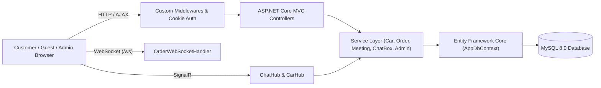

# Car E-Commerce & Showroom Management System (ManageCars)

Hệ thống thương mại điện tử kết hợp quản lý đặt lịch hẹn xem xe và tư vấn trực tuyến theo thời gian thực (**ManageCars**), được xây dựng trên nền tảng **C# / ASP.NET Core 8.0 MVC**, **Entity Framework Core**, **SignalR**, **WebSocket** và **MySQL**.

---

## Công nghệ sử dụng (Tech Stack)

- **Backend Framework:** C#, .NET 8.0, ASP.NET Core MVC
- **ORM & Cơ sở dữ liệu:** Entity Framework Core 8 (Code-First Migrations), Pomelo.EntityFrameworkCore.MySql, MySQL 8.0
- **Thời gian thực (Real-time):**
  - **SignalR (`ChatHub`, `CarHub`):** Hệ thống Live Chat tư vấn trực tuyến giữa Khách hàng/Khách vãng lai với Admin và đồng bộ dữ liệu danh mục xe theo thời gian thực.
  - **Native WebSocket (`OrderWebSocketHandler`):** Cập nhật và thông báo trạng thái đơn hàng tức thời tại endpoint `/ws`.
- **Bảo mật & Middleware:** Cookie-based Authentication (`MyCookieAuth`), Role-Based Authorization (`Admin` / `User`), Session Management, cùng chuỗi Custom Middleware (`ExceptionMiddleware`, `GuestMiddleware`, `LoginMiddleware`, `VisitorTrackingMiddleware`).
- **Frontend:** Razor Views (`.cshtml`), HTML5, CSS3, Bootstrap 5, JavaScript (AJAX / Fetch API, SignalR Client).
- **Hạ tầng:** Docker Compose (MySQL 8.0 Container).

---

## Kiến trúc hệ thống



---

## Chức năng chính

### 1. Phân hệ Khách hàng & Khách vãng lai (Customer / Guest)
- **Danh mục & Thông số xe:** Tra cứu danh sách xe theo hãng/phân khúc (`CarCategorys`), xem chi tiết thông số kỹ thuật (`CarDetail`), tìm kiếm, lọc đa tiêu chí và phân trang động (`CarSearchCriteria`, `PagingRequest`).
- **Đặt mua xe & Theo dõi đơn hàng:** Tạo đơn đặt hàng (`Order`), theo dõi tiến độ xử lý đơn hàng cập nhật trực tiếp qua WebSocket.
- **Đặt lịch hẹn Showroom (`Meeting`):** Đăng ký lịch hẹn xem xe thực tế hoặc lái thử gắn liền với đơn hàng.
- **Tư vấn trực tuyến (Real-time Live Chat):** Nhắn tin trao đổi trực tiếp với Quản trị viên qua **SignalR (`ChatHub`)**, hỗ trợ định danh tự động cho cả tài khoản thành viên và khách vãng lai (`GuestMiddleware`).
- **Quản lý tài khoản:** Đăng ký, đăng nhập (`CookieAuthentication`), quản lý thông tin cá nhân (`Profile`).

### 2. Phân hệ Quản trị viên (Admin)
- **Bảng điều khiển (Admin Dashboard):** Thống kê doanh thu theo tháng (`MonthlySalesDto`), số lượng đơn hàng và lượt truy cập hệ thống (`VisitorLog`).
- **Quản lý kho xe (`CarManager`):** Thêm mới, cập nhật thông tin, hình ảnh, thông số kỹ thuật chi tiết và đồng bộ hiển thị qua `CarHub`.
- **Quản lý đơn hàng & Lịch hẹn (`ManagerOrder`, `Meetinglist`):** Duyệt đơn hàng, chuyển đổi trạng thái đơn và quản lý lịch hẹn khách tới showroom.
- **Trung tâm CSKH trực tuyến (`AdminMessage`):** Quản lý danh sách hội thoại (`Conversation`), theo dõi trạng thái người dùng đang trực tuyến (`OnlineUserTracker`) và phản hồi khách hàng theo thời gian thực.

---

## Cấu trúc thư mục

- `Controllers/` & `Controllers/Service/`: Tầng điều hướng HTTP và tầng xử lý logic nghiệp vụ (`CarService`, `OrderService`, `MeetingService`, `ChatBoxService`, `AdminService`, `HomeService`).
- `Hubs/`: Các SignalR Hub xử lý kết nối thời gian thực (`ChatHub.cs`, `CarHub.cs`).
- `Middleware/`: Các lớp xử lý trung gian cho ngoại lệ toàn cục, phiên khách vãng lai, kiểm tra đăng nhập và WebSocket đơn hàng.
- `Models/`: Các lớp thực thể Entity Framework (`Car`, `CarDetail`, `CarCategorys`, `Order`, `Meeting`, `User`, `Conversation`, `Message`, `VisitorLog`), DTO/Request và ViewModel.
- `Migrations/`: Lịch sử khởi tạo và cập nhật cấu trúc bảng cơ sở dữ liệu (EF Core Migrations).
- `Views/`: Giao diện người dùng Razor Views chia theo từng phân hệ.
- `wwwroot/`: Tài nguyên tĩnh (CSS, JavaScript xử lý giao diện, phân trang và kết nối SignalR/WebSocket).

---

## Hướng dẫn cài đặt và Chạy dự án (Local Development)

### 1. Khởi chạy cơ sở dữ liệu MySQL bằng Docker Compose

```powershell
docker-compose up -d
```

Mặc định MySQL 8.0 sẽ chạy ở cổng `3306` với thông tin cấu hình trong `docker-compose.yml` và `appsettings.json` (`Database=webfirst`).

### 2. Cập nhật Schema cơ sở dữ liệu (EF Core Migrations)

```powershell
dotnet ef database update
```

### 3. Build và Chạy ứng dụng

```powershell
dotnet restore
dotnet run
```

Sau khi khởi động, truy cập ứng dụng trên trình duyệt theo cổng hiển thị trên cửa sổ Terminal (ví dụ: `https://localhost:7xxx` hoặc `http://localhost:5xxx`).
